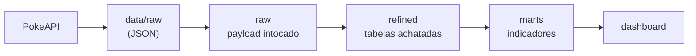

# Pokémon da 1ª geração: pipeline de dados

Projeto do Desafio Final da Trilha Engenharia de Dados JR.
Baixa os 151 Pokémon originais da PokeAPI, organiza em três camadas no DuckDB (`raw`, `refined`, `marts`) e mostra os indicadores em um painel Streamlit.

## Fonte do dado

- **PokeAPI** (<https://pokeapi.co>, [documentação](https://pokeapi.co/docs/v2)): API pública e gratuita, sem chave.
- Código e dados do projeto PokeAPI sob licença BSD-3-Clause (<https://github.com/PokeAPI/pokeapi>).
- Pokémon é marca registrada da Nintendo, Game Freak e Creatures. Este é um uso educacional, sem fins comerciais.
- **Escopo:** ids 1 a 151, nos endpoints `pokemon/{id}`, `pokemon-species/{id}` e `type/{name}` (só os 17 tipos que aparecem nesses Pokémon).
- **Data da extração:** 2026-11-02. A data de cada arquivo fica em `data/raw/_manifest.json`.

## As três camadas



| Camada | O que faz | Onde está o código |
|---|---|---|
| `data/raw` | Resposta da API exatamente como veio, com cache e manifest | `src/extract.py` |
| `raw` | Uma linha por arquivo, com o JSON sem alteração | `src/load_raw.py` |
| `refined` | JSON achatado, unidades convertidas, regras aplicadas | `src/transform.py`, `sql/refined/` |
| `marts` | Um indicador por arquivo `.sql`, sempre com JOIN | `sql/marts/` |
| dashboard | Só lê `marts`, sem nenhum cálculo | `dashboard/app.py` |

`python run_pipeline.py` executa em ordem: extract, raw, refined, marts e checks. Se uma conferência não bater, o pipeline para com erro.

## O que é uma linha de cada tabela

| Tabela | Uma linha é | Linhas |
|---|---|---:|
| `raw.pokemon` | um arquivo `pokemon/{id}.json` | 151 |
| `raw.pokemon_species` | um arquivo `pokemon_species/{id}.json` | 151 |
| `raw.type` | um arquivo `type/{name}.json` | 17 |
| `refined.pokemon` | um Pokémon, com `artwork_url` e `sprite_url` (nuláveis) | 151 |
| `refined.species` | uma espécie, com `genus` em inglês (nulável) | 151 |
| `refined.pokemon_type` | um tipo de um Pokémon (`pokemon_id`, `slot`, `type_name`) | 218 |
| `refined.pokemon_ability` | uma habilidade de um Pokémon (`pokemon_id`, `ability_name`, `is_hidden`, `slot`) | 395 |
| `refined.pokemon_move` | uma forma de um Pokémon aprender um golpe em Red/Blue (`pokemon_id`, `move_name`, `learn_method`, `min_level`) | 4.128 |
| `refined.type_damage` | um par atacante e defensor com multiplicador diferente de 1 (`attacking_type`, `defending_type`, `multiplier`) | 110 |
| `marts.mart_stats_por_tipo` | um tipo | 17 |
| `marts.mart_top10_total_stats` | um Pokémon do ranking | 10 |
| `marts.mart_lendarios_vs_comuns` | uma categoria (lendário, mítico, comum) | 3 |
| `marts.mart_fraquezas_por_tipo` | um tipo defensivo | 17 |
| `marts.mart_habitat` | um habitat | 9 |
| `marts.mart_habilidades_mais_comuns` | uma habilidade do top 15 | 15 |
| `marts.mart_cadeias_evolucao` | uma cadeia de evolução | 78 |
| `marts.mart_resumo_geral` | o conjunto de KPIs | 1 |
| `marts.mart_pokedex` | um Pokémon, com tudo o que o cartão da Pokédex exibe | 151 |

## Indicadores

| Indicador | Pergunta que responde | Arquivo |
|---|---|---|
| Stats por tipo | Quais tipos têm, em média, os Pokémon mais fortes em cada atributo? Tipo duplo conta nos dois tipos. | [mart_stats_por_tipo.sql](sql/marts/mart_stats_por_tipo.sql) |
| Top 10 | Quais os 10 mais fortes por `total_stats`, e são lendários ou míticos? | [mart_top10_total_stats.sql](sql/marts/mart_top10_total_stats.sql) |
| Lendários vs comuns | Lendários e míticos são mais fortes e mais difíceis de capturar? | [mart_lendarios_vs_comuns.sql](sql/marts/mart_lendarios_vs_comuns.sql) |
| Fraquezas por tipo | Quantos tipos causam 2x, 0.5x e 0x em cada tipo defensivo? | [mart_fraquezas_por_tipo.sql](sql/marts/mart_fraquezas_por_tipo.sql) |
| Habitat | Quantos Pokémon há em cada habitat e qual a força média? | [mart_habitat.sql](sql/marts/mart_habitat.sql) |
| Habilidades | Quais as 15 habilidades em mais Pokémon, como normal e como oculta? | [mart_habilidades_mais_comuns.sql](sql/marts/mart_habilidades_mais_comuns.sql) |
| Cadeias de evolução | Quantos Pokémon cada cadeia tem e qual o maior `total_stats`? | [mart_cadeias_evolucao.sql](sql/marts/mart_cadeias_evolucao.sql) |
| Resumo geral | Qual o retrato geral em uma linha? | [mart_resumo_geral.sql](sql/marts/mart_resumo_geral.sql) |
| Pokédex | Como é o cartão de cada Pokémon, com tudo pronto para exibir? | [mart_pokedex.sql](sql/marts/mart_pokedex.sql) |

## Dashboard

`streamlit run dashboard/app.py` abre um painel com duas abas:

- **Pokédex** (aba inicial): cartão de um Pokémon, escolhido na busca com o botão "Buscar" (padrão: Pikachu). À esquerda, radar e barras dos 6 stats; no centro, nome, tipos, número, selo de lendário ou mítico, altura, peso e `genus`; à direita, artwork e sprite. Tudo vem de `mart_pokedex`.
- **Indicadores**: os KPIs, filtros e gráficos dos demais marts.

As imagens não ficam no projeto: `mart_pokedex` guarda as URLs informadas pela PokeAPI e quem baixa é o navegador, **então é preciso internet para elas aparecerem**. Sem internet, ou com URL nula, o cartão mostra um aviso discreto e o restante continua funcionando.

Os nomes têm só a primeira letra em maiúscula, como o dado da API: aparecem `Mr-mime`, `Nidoran-f` e `Farfetchd`.

## Documentação

- [docs/SPEC.md](docs/SPEC.md): especificação etapa por etapa e como cada etapa foi verificada.
- [docs/spec/](docs/spec/): prompts originais usados como especificação.
- [docs/decisoes.md](docs/decisoes.md): motivo de cada decisão sobre o dado.
- [docs/conferencia.md](docs/conferencia.md): contagens entre as camadas, geradas pelo pipeline.

## Decisões sobre o dado

O motivo de cada decisão está em [docs/decisoes.md](docs/decisoes.md). As principais:

- **Dados atuais, não os de 1996.** Tipos, stats, relações de dano e habilidades são os de hoje: Clefairy aparece como fairy, um tipo que não existia na época. Os campos `past_*` continuam na camada raw.
- **Golpes só de `red-blue`.** As 163.908 linhas de todas as versões viram 4.128, sem duplicar. O mesmo golpe em níveis diferentes continua em duas linhas, porque são dois momentos de aprendizado.
- **Altura e peso convertidos.** A API usa decímetros e hectogramas; as tabelas usam metros e kg.
- **Tipo duplo conta nos dois tipos.** Por isso a soma em `mart_stats_por_tipo` é 218, não 151.
- **Só os 17 tipos dos 151.** Além de `unknown`, `shadow` e `stellar`, fica de fora `dark`. Ghost e psychic aparecem com uma fraqueza a menos do que têm no jogo.
- **`habitat` nulo continua nulo.** Nos 151 de hoje nenhum vem nulo, então a linha "sem informação" não aparece no resultado real; ela é coberta por teste.
- **Empate no top 15 de habilidades.** Oito empatam com 6 Pokémon e o corte é alfabético: `rivalry`, `shed-skin`, `static`, `sturdy` e `unnerve` ficam de fora.
- **Escala única na Pokédex.** Barras e radar vão de 0 a `stat_max_escala` (250, o HP do Chansey), calculado no SQL, para comparar Pokémon entre si. Por isso a maioria ocupa menos da metade da escala.
- **A camada raw fica fora do git.** São cerca de 48 MB, recriados por `python run_pipeline.py`.

## Como rodar do zero

Requer Python 3.10 ou mais novo e internet na primeira execução.

**Windows (PowerShell)**

```powershell
git clone https://github.com/laysoncrisley/pokemon-pipeline.git
cd pokemon-pipeline
python -m venv .venv
.venv\Scripts\activate
pip install -r requirements.txt
python run_pipeline.py        # primeira vez baixa da API (~1-2 min)
pytest -v
streamlit run dashboard/app.py
```

**Linux/Mac**

```bash
git clone https://github.com/laysoncrisley/pokemon-pipeline.git && cd pokemon-pipeline
python -m venv .venv
source .venv/bin/activate
pip install -r requirements.txt
python run_pipeline.py        # primeira vez baixa da API (~1-2 min)
pytest -v
streamlit run dashboard/app.py
```

Observações:

- A partir da segunda vez, o pipeline usa o cache em `data/raw`. Para baixar tudo de novo: `python run_pipeline.py --refresh`.
- Os testes não usam internet nem o banco do projeto: `tests/conftest.py` faz o teste falhar se tentar qualquer um dos dois.
- O painel lê só o banco local, mas as imagens da aba Pokédex precisam de internet (ver [Dashboard](#dashboard)).
- Se o PowerShell bloquear a ativação do venv, rode antes `Set-ExecutionPolicy -Scope Process RemoteSigned`.

**Onde já foi testado:** Windows 10 com Python 3.14 e 3.12. Linux, Mac e Python 3.10 ainda não foram executados.

## Conferência

Contagens antes e depois de cada camada, copiadas de [docs/conferencia.md](docs/conferencia.md), que o pipeline gera a cada execução.

| Conferência | Esperado | Obtido | Resultado |
|---|---:|---:|---|
| raw.pokemon: linhas | 151 | 151 | OK |
| raw.pokemon_species: linhas | 151 | 151 | OK |
| raw.pokemon: id do payload diferente do nome do arquivo | 0 | 0 | OK |
| raw.pokemon_species: id do payload diferente do nome do arquivo | 0 | 0 | OK |
| raw.pokemon: payload diferente do arquivo em disco | 0 | 0 | OK |
| raw.pokemon_species: payload diferente do arquivo em disco | 0 | 0 | OK |
| raw.type: payload diferente do arquivo em disco | 0 | 0 | OK |
| refined.pokemon: linhas (raw.pokemon) | 151 | 151 | OK |
| refined.species: linhas (raw.pokemon_species) | 151 | 151 | OK |
| refined.pokemon_type: linhas (soma de len(types) no raw) | 218 | 218 | OK |
| refined.pokemon_ability: linhas (soma de len(abilities) no raw) | 395 | 395 | OK |
| Golpes ANTES da regra: linhas de version_group_details no raw | - | 163908 | registro |
| Golpes de red-blue no raw, antes do distinto | - | 4128 | registro |
| Golpes DEPOIS da regra: refined.pokemon_move (red-blue) | - | 4128 | registro |
| refined.pokemon_move: repetidos no grão | 0 | 0 | OK |
| Pokémon sem nenhum golpe na regra | 0 | 0 | OK |
| Anti-join refined.pokemon sem refined.species | 0 | 0 | OK |
| Anti-join refined.species sem refined.pokemon | 0 | 0 | OK |
| pokemon_id = species_id com nome diferente | 0 | 0 | OK |
| Anti-join refined.pokemon_type sem refined.pokemon | 0 | 0 | OK |
| Anti-join refined.pokemon_ability sem refined.pokemon | 0 | 0 | OK |
| Anti-join refined.pokemon_move sem refined.pokemon | 0 | 0 | OK |
| Espécies fora da generation-i | 0 | 0 | OK |
| Tipos de pokemon_type sem linha em raw.type | 0 | 0 | OK |
| Relações de dano ANTES do filtro de tipos (sentido *_to) | - | 115 | registro |
| Relações de dano DEPOIS do filtro: refined.type_damage | 110 | 110 | OK |
| Relações *_to que não aparecem em *_from, ou o inverso (dentro do escopo) | 0 | 0 | OK |
| mart_stats_por_tipo: soma de qtd_pokemon (linhas de pokemon_type) | 218 | 218 | OK |
| mart_top10_total_stats: Pokémon distintos | 10 | 10 | OK |
| mart_lendarios_vs_comuns: soma de qtd_pokemon | 151 | 151 | OK |
| mart_fraquezas_por_tipo: soma das relações (linhas de type_damage) | 110 | 110 | OK |
| mart_habitat: soma de qtd_pokemon | 151 | 151 | OK |
| mart_habitat: Pokémon na linha 'sem informação' (habitat nulo em refined.species) | 0 | 0 | OK |
| mart_habilidades_mais_comuns: linhas | 15 | 15 | OK |
| mart_habilidades_mais_comuns: normal + oculta diferente do total | 0 | 0 | OK |
| mart_cadeias_evolucao: soma de qtd_pokemon | 151 | 151 | OK |
| mart_resumo_geral: total_pokemon | 151 | 151 | OK |
| mart_pokedex: linhas | 151 | 151 | OK |

## Onde a IA errou ou assumiu algo

O projeto foi construído com ajuda de IA (Claude Code). Estes são os casos reais desta construção. Nenhuma conferência do pipeline reprovou na versão final, porque os pontos abaixo foram tratados antes, a maioria ao contar linhas e abrir o dado.

**Suposições que o dado desmentiu**

- **`habitat` nulo.** O enunciado e a primeira leitura da IA assumiam que haveria habitat nulo. Contando os 151, não há nenhum. A linha "sem informação" prevista para `mart_habitat` não aparece no resultado real. A regra foi mantida e testada com dado inventado, e isso ficou registrado em vez de parecer que a linha existe.
- **Tipos fora do escopo.** A lista esperada era `unknown`, `shadow` e `stellar`. Ao baixar, apareceram 17 tipos e `dark` não estava entre eles, embora apareça nas relações de dano dos outros. Descoberto porque `*_to` deu 115 linhas e `*_from` deu 114, com os tipos fora dos 17 listados ao lado. Sem o filtro, `type_damage` teria linhas de um tipo que não existe no projeto.
- **Golpes únicos em `red-blue`.** A expectativa era de que filtrar a versão resolvesse a repetição por Pokémon + golpe + método. A contagem mostrou 101 combinações em mais de um nível, como Electrode com `sonic-boom`. Não é duplicata, e `min_level` precisa ficar na chave.
- **Métodos de aprendizado.** A contagem por método revelou `stadium-surfing-pikachu`, além de `level-up` e `machine`.
- **"Só os tipos mudaram."** O enunciado alertava para os tipos atuais. Ao abrir o JSON, a IA viu que o problema é mais amplo: `past_stats` existe nos 151 e `past_damage_relations` em 7 tipos. Stats e relações de dano também são atuais. Exemplo: ghost não afetava psychic na 1ª geração e hoje causa 2x.
- **Imagem e `genus` nulos.** O pedido da Pokédex previa nulos nesses campos. Contando os 151, não há nenhum `artwork_url`, `sprite_url` ou `genus` nulo. O tratamento foi mantido e testado com dado inventado e com uma cópia do banco em que os campos do Pikachu foram anulados, porque com o dado real esse caminho nunca executaria.
- **Primeira letra maiúscula não basta para todos os nomes.** A regra pedida funciona para Pikachu, mas o nome da API vira `Mr-mime`, `Nidoran-f`, `Nidoran-m` e `Farfetchd`. A regra foi mantida como pedida, e os nomes continuam únicos, o que a busca exige.
- **Escala das barras.** O maior stat individual é um caso isolado: o HP 250 do Chansey, seguido de 180 (Cloyster). A mediana do maior stat de cada Pokémon é 100, então a barra mais longa de um Pokémon típico ocupa só 40% do trilho. Mewtwo chega a 154, cerca de 62%. O motivo de manter essa escala está em [docs/decisoes.md](docs/decisoes.md).

**Riscos encontrados contando ou olhando o dado**

- **Golpes repetidos por versão.** 163.908 linhas viraram 4.128 com a regra. A contagem antes e depois fica registrada na conferência.
- **Empate escondido no top 15.** O ranking de habilidades parecia correto até a IA listar também as posições seguintes: oito habilidades empatam com 6 Pokémon e cinco ficam de fora só pela ordem alfabética.
- **Unidade de altura e peso.** Conferida no JSON real: Bulbasaur vem com `height: 7` e `weight: 69`, que viram 0,7 m e 6,9 kg.
- **Tipos atuais vs originais.** Conferido em `past_types`: 7 dos 151 mudaram, como Clefairy (normal, hoje fairy) e Magnemite (electric, hoje electric/steel).

**Nomes de campo**

Os JSONs foram baixados e abertos antes de escrever as transformações, então nenhum erro de nome chegou ao código. O que estava diferente do esperado: `special-attack` e `special-defense` vêm com hífen, `min_level` na API se chama `level_learned_at`, e `evolution_chain` só traz a `url`, sem id.

**Erros de processo**

- **Commit errado.** Um `git add -A` colocou os testes dentro do commit de `refined`, o que quebraria a regra de um commit por etapa. Percebido com `git show --stat` e separado antes de continuar.
- **"O servidor subiu" não prova que o painel funciona.** O Streamlit só executa o script quando uma sessão se conecta, e a primeira captura de tela pegou apenas o esqueleto da página. A verificação passou a executar o script com `AppTest`, incluindo os filtros, e a olhar o painel renderizado em um navegador real.
- **Layout que só a captura de tela mostrou.** Na primeira versão da Pokédex, as medições automáticas passaram (cores aplicadas, nenhuma rolagem horizontal, nenhum erro), mas a captura mostrou o KPI "Maior total de stats" cortado como `mewtw…`, a legenda pálida porque o CSS não alcançava o elemento interno, e o sprite abaixo da dobra em 768 px. Os três foram corrigidos.
- **Falso alarme no teste sem imagens.** Com as imagens bloqueadas, o radar apareceu vazio na captura e parecia um defeito. Essa captura foi tirada após uma espera fixa de 3 segundos, com outra aba aberta. Repetido em uma página única, esperando o gráfico aparecer, o radar renderizou normalmente. A causa exata não foi isolada.

### Conferência feita por mim (autor)

- **Contagem de tipos:** rodei uma consulta direto no banco e encontrei 84 Pokémon com 1 tipo e 67 com 2 tipos. A conta 84 + 67 × 2 = 218 bate com as 218 linhas de `refined.pokemon_type` e com o número registrado em `docs/conferencia.md`. Isso confirma que a transformação não duplicou nem perdeu tipos.
- **Tipo `dark`:** o enunciado que passei para a IA citava só `unknown`, `shadow` e `stellar` como tipos fora do escopo. Listei todos os tipos no banco e apareceram 17, nenhum `dark`, que só surgiu na 2ª geração. A IA percebeu isso durante o perfil dos dados, mas a suposição inicial (minha e dela) estava incompleta. Consequência: em `mart_fraquezas_por_tipo`, ghost e psychic aparecem com uma fraqueza a menos do que têm no jogo atual.
- **Habitat nulo:** eu esperava encontrar Pokémon sem habitat e pedi uma linha "sem informação" no indicador de habitat. Nos 151 Pokémon reais nenhum habitat é nulo, então essa linha não aparece no resultado. A regra continua no SQL e é coberta por teste com dado inventado.
- **Comando de conferência com erro:** o primeiro comando que a IA me passou para conferir o tipo `dark` quebrou no PowerShell, por causa das aspas em `'dark'` (Binder Error). Troquei por uma consulta que lista todos os tipos com a contagem: apareceram 17 tipos, nenhum `dark`, e a soma da coluna deu 218, igual a `refined.pokemon_type`.

Comando que usei para conferir:

    python -c "import duckdb; c=duckdb.connect('warehouse/pokemon.duckdb', read_only=True); print(c.sql('select qtd_tipos, count(*) as pokemons from (select pokemon_id, count(*) as qtd_tipos from refined.pokemon_type group by 1) group by 1 order by 1')); print(c.sql('select type_name, count(*) as pokemons from refined.pokemon_type group by 1 order by 1').show(max_rows=30))"