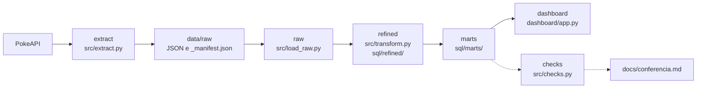

# Especificação do projeto

## 1. Introdução

A especificação deste projeto foi escrita antes da implementação, na forma de dois prompts guardados em [docs/spec/](spec/):

- [01_prompt_pipeline.md](spec/01_prompt_pipeline.md): especifica o pipeline completo, os testes, o painel e o README.
- [02_prompt_pokedex.md](spec/02_prompt_pokedex.md): especifica a mudança posterior do painel para o layout de Pokédex.

Este documento organiza essa especificação etapa por etapa, na ordem dos commits, e registra como cada etapa foi verificada. Os prompts continuam sendo o texto original; aqui não há requisito novo.

Dois pontos sobre a origem do material:

- Esta SPEC foi redigida depois da construção e os prompts só entraram no git depois do último commit de implementação. Portanto, o histórico não comprova sozinho que eles vieram antes. O que o git mostra é que as mensagens dos commits coincidem, na mesma ordem, com as listas de commits dos dois prompts.
- As fontes são somente o git, o código, os testes e [conferencia.md](conferencia.md). Quando não há registro de uma verificação, o texto diz isso.

## 2. Objetivo e perguntas que o projeto responde

O objetivo é entregar o Desafio Final da Trilha Engenharia de Dados JR: baixar os 151 Pokémon da 1ª geração de uma API pública, organizar o dado em três camadas no DuckDB (`raw`, `refined`, `marts`) e exibir os indicadores em um painel Streamlit que não calcula nada.

Perguntas respondidas, uma por indicador (detalhes na [seção 7](#7-indicadores)):

1. Quais tipos têm, em média, os Pokémon mais fortes em cada atributo?
2. Quais são os 10 Pokémon mais fortes por `total_stats`, e eles são lendários ou míticos?
3. Lendários e míticos são mais fortes e mais difíceis de capturar que os comuns?
4. Quantos tipos causam 2x, 0.5x e 0x em cada tipo defensivo?
5. Quantos Pokémon vivem em cada habitat e qual a força média em cada um?
6. Quais as 15 habilidades presentes em mais Pokémon, como normal e como oculta?
7. Quantos Pokémon cada cadeia de evolução tem e qual o maior `total_stats` dela?
8. Qual o retrato geral dos dados em uma linha só?
9. Como é o cartão de Pokédex de cada Pokémon, com tudo pronto para exibir?

## 3. Fonte do dado e escopo

- **Fonte:** PokeAPI (<https://pokeapi.co>, [documentação](https://pokeapi.co/docs/v2)), pública, gratuita e sem chave.
- **Licença:** código e dados do projeto PokeAPI sob BSD-3-Clause (<https://github.com/PokeAPI/pokeapi>). Pokémon é marca registrada da Nintendo, Game Freak e Creatures; o uso aqui é educacional, sem fins comerciais.
- **Data da extração:** 2026-11-02, segundo [conferencia.md](conferencia.md).

| Endpoint | Faixa | Campos usados | Destino |
|---|---|---|---|
| `GET /api/v2/pokemon/{id}` | ids 1 a 151 | stats, tipos, habilidades, golpes, altura, peso, sprites, experiência base | `data/raw/pokemon/{id}.json` |
| `GET /api/v2/pokemon-species/{id}` | ids 1 a 151 | is_legendary, is_mythical, capture_rate, base_happiness, habitat, color, growth_rate, generation, evolution_chain, genera | `data/raw/pokemon_species/{id}.json` |
| `GET /api/v2/type/{name}` | só os 17 tipos presentes nos 151 | damage_relations | `data/raw/type/{name}.json` |

## 4. Arquitetura

`python run_pipeline.py` executa, em ordem, extract, raw, refined, marts e checks. O painel é iniciado à parte, com `streamlit run dashboard/app.py`, e só lê.

- **extract:** grava o texto da resposta sem alteração, com cache em disco. `--refresh` força novo download.
- **raw:** uma linha por arquivo, com o JSON intocado.
- **refined:** `src/build.py` passa os payloads pelas funções puras de `src/transform.py`, publica o resultado como views `stg_*` e executa os `.sql` de `sql/refined/` em ordem.
- **marts:** um `.sql` por indicador, sempre com JOIN.
- **checks:** confere as contagens entre as camadas, imprime, grava [conferencia.md](conferencia.md) e faz o pipeline parar com erro se algo não bater.
- **dashboard:** abre o banco com `read_only=True` e faz apenas `SELECT * FROM marts.<tabela>`.

## 5. Passo a passo da construção

Há uma subseção por commit, na ordem de `git log --reverse`. Como ler o campo **Como foi verificado**:

- Os números vêm de [conferencia.md](conferencia.md), na versão atual, que é a saída da última execução registrada. A evolução do arquivo pode ser vista no git. Ele entrou no repositório em `38dbee9`.
- Muitos testes foram escritos em commits posteriores ao código que cobrem. Por isso, cada etapa indica o commit em que o teste apareceu.
- O repositório não guarda a saída de `pytest` nem do pipeline de cada commit, então esta SPEC não afirma que os testes foram rodados em cada um deles.
- Os totais de testes são contagens de funções `def test_` no arquivo. Hoje são 63 funções, que o pytest expande em 72 casos por causa da parametrização.

### 5.1 chore: estrutura inicial do projeto, requirements e .gitignore

- **Objetivo:** criar a base do projeto e a configuração central.
- **Entradas:** nenhuma.
- **Saídas:** `.gitignore`, `README.md` provisório, `data/raw/.gitkeep`, `pytest.ini`, `requirements.txt`, `src/__init__.py`, `src/config.py`.
- **Regras e decisões:** `data/raw/` e `warehouse/` ficam fora do git, porque são recriados pelo pipeline ([A camada raw não vai para o git](decisoes.md#a-camada-raw-não-vai-para-o-git)). `src/config.py` guarda caminhos, `BASE_URL` e a faixa de ids.
- **Critério de aceite** ([prompt 01](spec/01_prompt_pipeline.md)): stack Python, `requests`, DuckDB, pandas, pytest, Streamlit e plotly; nada de Makefile nem comando só-bash; só `data/raw/.gitkeep` commitado da camada raw.
- **Como foi verificado:** sem teste nem conferência nesta etapa. O resultado é visível em `git show --stat 0042182`, com `data/raw/.gitkeep` como único arquivo sob `data/raw`.
- **Commit:** `0042182`, 2026-11-02.

### 5.2 feat(extract): download da PokeAPI com cache e manifest

- **Objetivo:** baixar os três endpoints para o disco, sem alterar a resposta.
- **Entradas:** PokeAPI e `src/config.py`.
- **Saídas:** `src/extract.py`, `run_pipeline.py`; ao rodar, `data/raw/pokemon/`, `data/raw/pokemon_species/`, `data/raw/type/` e `data/raw/_manifest.json`.
- **Regras e decisões:**
  - O arquivo é igual à resposta da API, com `newline=""` e gravação por arquivo temporário ([O arquivo é igual ao que a API devolveu](decisoes.md#o-arquivo-é-igual-ao-que-a-api-devolveu-byte-a-byte)).
  - Só erro de conexão, HTTP 5xx e 429 são repetidos ([Só erros transitórios são repetidos](decisoes.md#só-erros-transitórios-são-repetidos)).
  - A lista de tipos sai dos Pokémon baixados.
- **Critério de aceite** ([prompt 01](spec/01_prompt_pipeline.md)):
  - `requests.Session` com `User-Agent: desafio-engenharia-dados-jr`, timeout de 30 s, 3 tentativas com espera crescente e `time.sleep(0.2)` entre chamadas.
  - Cache por existência do arquivo e `--refresh` para forçar novo download.
  - JSON salvo como veio (`response.text`).
  - `_manifest.json` com url, status HTTP e timestamp.
- **Como foi verificado:**
  - Testes em `tests/test_extract.py`, com HTTP mockado, escritos depois, em `77e29ac` (11 funções): cache, `--refresh`, gravação sem alteração, manifest, retentativa, 404 sem repetição e falha que não deixa arquivo no cache.
  - [conferencia.md](conferencia.md): 0 payloads diferentes do arquivo em disco, nas três tabelas raw.
  - [decisoes.md](decisoes.md) registra que dois arquivos foram comparados com `cmp` contra um download feito com `curl`, no início do projeto.
- **Commit:** `1b07f21`, 2026-11-02.

### 5.3 feat(raw): carga dos JSONs brutos no DuckDB

- **Objetivo:** carregar cada arquivo como uma linha, com o payload intocado.
- **Entradas:** `data/raw/`.
- **Saídas:** `src/load_raw.py`, ajuste em `run_pipeline.py`; tabelas `raw.pokemon`, `raw.pokemon_species` e `raw.type`.
- **Regras e decisões:** o schema é recriado a cada execução, com chave primária no identificador. O nome do arquivo vira a chave, e a conferência compara esse valor com o `id` do payload nas tabelas `pokemon` e `species`.
- **Critério de aceite** ([prompt 01](spec/01_prompt_pipeline.md)): uma linha por arquivo, com `payload JSON`, `source_url` e `loaded_at`; 151 linhas em `raw.pokemon` e em `raw.pokemon_species`.
- **Como foi verificado:**
  - [conferencia.md](conferencia.md): `raw.pokemon` 151 de 151; `raw.pokemon_species` 151 de 151; 0 ids de payload diferentes do nome do arquivo; 0 payloads diferentes do disco. Essas conferências só existem a partir de `38dbee9`.
  - Não há arquivo de teste só para `load_raw`. O código roda na fixture `con_inventado` de `tests/conftest.py`, e `test_payload_alterado_na_raw_e_detectado` (de `77e29ac`) prova que a conferência detecta um payload alterado.
- **Commit:** `43dbf2e`, 2026-11-02.

### 5.4 feat(refined): tabelas pokemon e species

- **Objetivo:** achatar os dois JSONs principais em tabelas com chave.
- **Entradas:** `raw.pokemon` e `raw.pokemon_species`.
- **Saídas:** `src/transform.py`, `src/build.py`, [01_pokemon.sql](../sql/refined/01_pokemon.sql), [02_species.sql](../sql/refined/02_species.sql), ajuste em `run_pipeline.py`; tabelas `refined.pokemon` e `refined.species`.
- **Regras e decisões:**
  - [Altura e peso convertidos](decisoes.md#altura-e-peso-convertidos) para metros e kg.
  - [Colunas que não têm o mesmo nome na API](decisoes.md#colunas-que-não-têm-o-mesmo-nome-na-api), incluindo `evolution_chain_id`, extraído da url.
  - [`habitat` nulo continua nulo](decisoes.md#habitat-nulo-continua-nulo).
  - [Chave primária nas tabelas refined](decisoes.md#chave-primária-nas-tabelas-refined).
  - [`pokemon_id` e `species_id` usados como chave do JOIN](decisoes.md#pokemon_id-e-species_id-usados-como-chave-do-join).
- **Critério de aceite** ([prompt 01](spec/01_prompt_pipeline.md)): 1 linha por Pokémon e por espécie, com as colunas listadas; `transform.py` com funções puras; `pokemon_id` e `species_id` confirmados por anti-join antes de virar chave; JSONs reais abertos antes de escrever as transformações.
- **Como foi verificado:**
  - [conferencia.md](conferencia.md), a partir de `38dbee9`: `refined.pokemon` 151 de 151; `refined.species` 151 de 151; anti-join nos dois sentidos 0 e 0; 0 ids iguais com nome diferente; 0 espécies fora da `generation-i`.
  - Testes em `tests/test_transform.py`, de `77e29ac`: `test_altura_em_decimetros_vira_metros`, `test_peso_em_hectogramas_vira_kg`, `test_stats_com_hifen_viram_colunas_e_total_soma_os_seis`, `test_evolution_chain_id_vem_da_url`, `test_url_de_cadeia_inesperada_falha_em_vez_de_inventar_id`, `test_habitat_nulo_continua_nulo`, `test_habitat_preenchido_vira_o_nome`, `test_species_achata_os_campos_aninhados`, `test_refined_real_preserva_habitat_nulo_no_banco` e `test_refined_real_grava_metros_e_kg`.
- **Commit:** `23a645a`, 2026-11-02.

### 5.5 feat(refined): tabelas de tipos, habilidades, golpes e relações de dano

- **Objetivo:** criar as tabelas filhas e a conferência entre camadas.
- **Entradas:** `raw.pokemon`, `raw.type` e `refined.pokemon_type` (filtro de `type_damage`).
- **Saídas:** `src/checks.py`, [docs/conferencia.md](conferencia.md), [03_pokemon_type.sql](../sql/refined/03_pokemon_type.sql), [04_pokemon_ability.sql](../sql/refined/04_pokemon_ability.sql), [05_pokemon_move.sql](../sql/refined/05_pokemon_move.sql), [06_type_damage.sql](../sql/refined/06_type_damage.sql), ajustes em `src/transform.py`, `src/build.py` e `run_pipeline.py`; tabelas `refined.pokemon_type`, `refined.pokemon_ability`, `refined.pokemon_move` e `refined.type_damage`.
- **Regras e decisões:**
  - [Golpes só de `red-blue`](decisoes.md#critério-só-o-version_group-red-blue-distinto-por-golpe-método-e-nível), e [o mesmo golpe em níveis diferentes não é duplicata](decisoes.md#o-mesmo-golpe-em-níveis-diferentes-não-é-duplicata).
  - [`min_level` fica 0 para quem não aprende por nível](decisoes.md#min_level-fica-0-para-quem-não-aprende-por-nível).
  - [Tipos, stats, habilidades e dano são os atuais](decisoes.md#tipos-stats-habilidades-e-dano-são-os-atuais-não-os-de-1996).
  - [Só tipos presentes nos 151](decisoes.md#só-tipos-presentes-nos-151), e [os dois lados do par precisam estar nos 151](decisoes.md#os-dois-lados-do-par-precisam-estar-nos-151).
  - [`type_damage` usa só o sentido `*_to`](decisoes.md#type_damage-usa-só-o-sentido-_to).
- **Critério de aceite** ([prompt 01](spec/01_prompt_pipeline.md)): soma de `len(types)` no raw igual às linhas de `pokemon_type`; soma de `len(abilities)` igual às linhas de `pokemon_ability`; linhas de golpes contadas antes e depois da regra; anti-join das filhas contra `refined.pokemon` igual a 0; resultado gravado em `docs/conferencia.md` e impresso pelo pipeline.
- **Como foi verificado:**
  - [conferencia.md](conferencia.md), já neste commit:

    | Conferência | Esperado | Obtido |
    |---|---:|---:|
    | `refined.pokemon_type` contra soma de `len(types)` | 218 | 218 |
    | `refined.pokemon_ability` contra soma de `len(abilities)` | 395 | 395 |
    | Golpes antes da regra | registro | 163.908 |
    | Golpes de `red-blue`, antes do distinto | registro | 4.128 |
    | Golpes depois da regra | registro | 4.128 |
    | `refined.pokemon_move`: repetidos no grão | 0 | 0 |
    | Pokémon sem golpe na regra | 0 | 0 |
    | Anti-join de `pokemon_type`, `pokemon_ability` e `pokemon_move` | 0 | 0 |
    | Relações de dano antes do filtro | registro | 115 |
    | Relações de dano depois do filtro | 110 | 110 |
    | Relações `*_to` e `*_from` divergentes, no escopo | 0 | 0 |

  - Testes de `77e29ac`: `test_pokemon_com_dois_tipos_gera_duas_linhas_com_slot`, `test_habilidades_mantem_oculta_e_slot`, os testes de golpes (`test_golpe_repetido_em_outra_versao_nao_duplica`, `test_golpe_em_nivel_ou_metodo_diferente_continua_separado`, `test_golpe_que_so_existe_em_outra_versao_fica_de_fora`, `test_contagem_de_golpes_antes_e_depois_da_regra`, `test_refined_real_grava_golpes_sem_duplicar`), `test_dano_le_so_o_sentido_to` e `test_refined_real_descarta_tipo_fora_do_escopo_nos_dois_lados`.
- **Commit:** `38dbee9`, 2026-11-02.

### 5.6 test: testes de extração e transformação com dado inventado

- **Objetivo:** cobrir extração, transformação e conferência sem rede e sem o banco do projeto.
- **Entradas:** código das etapas anteriores e JSONs inventados.
- **Saídas:** `tests/conftest.py`, `tests/test_extract.py` (11 funções), `tests/test_transform.py` (19 funções), `tests/test_checks.py` (6 funções) e 4 fixtures em `tests/fixtures/`.
- **Regras e decisões:** `tests/conftest.py` faz o teste falhar se tentar abrir um socket ou o arquivo `pokemon.duckdb`. `tests/test_checks.py` parte da ideia de que a conferência só vale se for capaz de reprovar, então provoca o erro de propósito.
- **Critério de aceite** ([prompt 01](spec/01_prompt_pipeline.md)): 3 a 4 JSONs inventados, incluindo um Pokémon com 2 tipos, um habitat nulo e um golpe repetido em duas versões; testes de altura e peso, tipos com slot, `evolution_chain_id`, deduplicação de golpes e habitat nulo; cache e salvamento com HTTP mockado; nenhum teste abre o banco nem acessa a API.
- **Como foi verificado:** o isolamento vale para todos os testes, porque a fixture `isolamento` é `autouse`. O [README](../README.md#onde-a-ia-errou-ou-assumiu-algo) registra um erro de processo desta etapa: um `git add -A` colocou os testes no commit de `refined`, o que foi percebido com `git show --stat` e separado.
- **Commit:** `77e29ac`, 2026-11-02.

### 5.7 feat(marts): indicadores de stats, ranking, lendários e fraquezas

- **Objetivo:** criar o schema `marts` e os quatro primeiros indicadores.
- **Entradas:** `refined.pokemon`, `refined.species`, `refined.pokemon_type` e `refined.type_damage`.
- **Saídas:** [mart_stats_por_tipo.sql](../sql/marts/mart_stats_por_tipo.sql), [mart_top10_total_stats.sql](../sql/marts/mart_top10_total_stats.sql), [mart_lendarios_vs_comuns.sql](../sql/marts/mart_lendarios_vs_comuns.sql), [mart_fraquezas_por_tipo.sql](../sql/marts/mart_fraquezas_por_tipo.sql), ajustes em `src/build.py` e `run_pipeline.py`.
- **Regras e decisões:**
  - [Tipo duplo conta nos dois tipos](decisoes.md#tipo-duplo-conta-nos-dois-tipos).
  - [Lendário, mítico e comum são categorias separadas](decisoes.md#lendário-mítico-e-comum-são-categorias-separadas).
  - [`capture_rate` maior significa captura mais fácil](decisoes.md#capture_rate-maior-significa-captura-mais-fácil).
  - [Empates nos rankings](decisoes.md#empates-nos-rankings).
  - [Médias com 2 casas, calculadas no SQL](decisoes.md#médias-com-2-casas-calculadas-no-sql).
- **Critério de aceite** ([prompt 01](spec/01_prompt_pipeline.md)): um `.sql` por indicador, com JOIN e comentário de pergunta, grão e origem; `ROW_NUMBER()` no top 10; tipo duplo contado nos dois e explicado no README; fraquezas com 2x, 0.5x e 0x.
- **Como foi verificado:** este commit não altera `src/checks.py`; as conferências destes marts entraram em `172e5e0`, e os testes, em `8fdf77b`.
  - [conferencia.md](conferencia.md): `mart_stats_por_tipo` soma 218 de 218; `mart_top10_total_stats` 10 de 10 Pokémon distintos; `mart_lendarios_vs_comuns` soma 151 de 151; `mart_fraquezas_por_tipo` soma 110 de 110.
  - Testes: `test_stats_por_tipo_conta_tipo_duplo_nos_dois`, `test_stats_por_tipo_calcula_as_medias`, `test_top10_ordena_desempata_e_corta`, `test_top10_junta_tipos_sem_repetir_pokemon_e_traz_categoria`, `test_lendarios_vs_comuns`, `test_fraquezas_conta_cada_multiplicador` e `test_fraquezas_mantem_tipo_sem_nenhuma_relacao`.
- **Commit:** `f81b3f2`, 2026-11-02.

### 5.8 feat(marts): indicadores de habitat, habilidades, evolução e resumo

- **Objetivo:** completar os oito indicadores do prompt 01 e fazer a conferência checar cada mart contra a refined de origem.
- **Entradas:** as tabelas `refined`.
- **Saídas:** [mart_habitat.sql](../sql/marts/mart_habitat.sql), [mart_habilidades_mais_comuns.sql](../sql/marts/mart_habilidades_mais_comuns.sql), [mart_cadeias_evolucao.sql](../sql/marts/mart_cadeias_evolucao.sql), [mart_resumo_geral.sql](../sql/marts/mart_resumo_geral.sql), ajuste em `src/checks.py`, 10 linhas novas em [conferencia.md](conferencia.md).
- **Regras e decisões:**
  - [Habitat nulo vira "sem informação" só no mart](decisoes.md#habitat-nulo-continua-nulo).
  - [Empates nos rankings](decisoes.md#empates-nos-rankings): o desempate por nome afeta o corte do top 15.
  - ["Separando ocultas e normais" vira duas colunas](decisoes.md#separando-ocultas-e-normais-vira-duas-colunas).
  - [Cadeias de evolução só contam os 151](decisoes.md#cadeias-de-evolução-só-contam-os-151).
- **Critério de aceite** ([prompt 01](spec/01_prompt_pipeline.md)): habitat incluindo "sem informação"; top 15 de habilidades, separando ocultas e normais; por cadeia, número de Pokémon e maior `total_stats`; resumo de 1 linha com os KPIs.
- **Como foi verificado:** os testes vieram em `8fdf77b`.
  - [conferencia.md](conferencia.md): `mart_habitat` soma 151 de 151; linha "sem informação" 0 de 0; `mart_habilidades_mais_comuns` 15 de 15 linhas e 0 casos de normal + oculta diferente do total; `mart_cadeias_evolucao` soma 151 de 151; `mart_resumo_geral` total 151 de 151.
  - Testes: `test_habitat_nulo_vira_sem_informacao`, `test_habilidades_separa_normal_e_oculta`, `test_habilidades_corta_em_15_e_desempata_pelo_nome`, `test_cadeias_evolucao` e `test_resumo_geral_tem_uma_linha_com_os_kpis`.
- **Commit:** `172e5e0`, 2026-11-02.

### 5.9 test: testes dos SQL dos marts em DuckDB em memória

- **Objetivo:** executar os `.sql` reais sobre dado inventado e conferir contra valores calculados à mão.
- **Entradas:** `sql/marts/*.sql` e tabelas refined inventadas no próprio teste.
- **Saídas:** `tests/test_sql_marts.py` (14 funções neste commit).
- **Regras e decisões:** a tabela de dados e os valores esperados ficam no cabeçalho do arquivo. Os dados incluem empate, tipo duplo, habitat nulo e o corte dos rankings.
- **Critério de aceite** ([prompt 01](spec/01_prompt_pipeline.md)): DuckDB `:memory:`, tabelas refined inventadas, `.sql` reais e valores calculados à mão.
- **Como foi verificado:** além dos testes citados em 5.7 e 5.8, `test_existe_um_sql_por_indicador` exige um arquivo por indicador e `test_sql_documenta_pergunta_grao_e_origem_e_usa_join` exige o comentário e o JOIN em cada `.sql`.
- **Commit:** `8fdf77b`, 2026-11-02.

### 5.10 feat(dashboard): painel Streamlit lendo só da camada marts

- **Objetivo:** exibir os indicadores sem nenhum cálculo na tela.
- **Entradas:** tabelas `marts` em `warehouse/pokemon.duckdb`.
- **Saídas:** `dashboard/app.py`.
- **Regras e decisões:** [o painel só lê a camada marts](decisoes.md#o-painel-só-lê-a-camada-marts), e a [conexão fica aberta só durante a leitura](decisoes.md#conexão-aberta-só-durante-a-leitura).
- **Critério de aceite** ([prompt 01](spec/01_prompt_pipeline.md)): `read_only=True`; apenas `SELECT * FROM marts.<tabela>`; KPIs, stats por tipo, top 10, lendários vs comuns, fraquezas, habitat e habilidades; filtros só filtram linhas; proibido groupby, média ou soma; `streamlit run` sobe sem erro.
- **Como foi verificado:** não há teste automatizado do painel no repositório. O [README](../README.md#onde-a-ia-errou-ou-assumiu-algo) registra que a primeira verificação (servidor no ar) não provava nada, porque o Streamlit só executa o script quando uma sessão se conecta, e que a verificação passou a usar `AppTest`, incluindo os filtros, e o painel renderizado em um navegador real. Os scripts e as capturas dessa verificação não estão no repositório.
- **Commit:** `457e6bc`, 2026-11-02.

### 5.11 docs: README completo, decisões sobre o dado e seção da IA

- **Objetivo:** documentar o projeto e o motivo de cada decisão.
- **Entradas:** as etapas anteriores e [conferencia.md](conferencia.md).
- **Saídas:** `README.md` e [docs/decisoes.md](decisoes.md).
- **Regras e decisões:** a seção "Onde a IA errou ou assumiu algo" registra só casos reais da construção.
- **Critério de aceite** ([prompt 01](spec/01_prompt_pipeline.md)): título e objetivo; fonte e licença; grão de cada tabela; camadas com mermaid; indicadores; decisões com link; como rodar em Windows e Linux/Mac; conferência copiada de `docs/conferencia.md`; seção da IA, terminando com um bloco `TODO (autor):`.
- **Como foi verificado:** não há teste automatizado de documentação. Ao redigir esta SPEC, em 2026-11-02, a tabela de conferência do README foi comparada com [conferencia.md](conferencia.md) e as 38 linhas são iguais.
- **Commit:** `e1d9193`, 2026-11-02.

### 5.12 docs: conferência manual do autor no README

- **Objetivo:** trocar o bloco `TODO (autor):` pela conferência feita pelo próprio autor.
- **Entradas:** `warehouse/pokemon.duckdb`, consultado diretamente.
- **Saídas:** seção "Conferência feita por mim (autor)" no `README.md`.
- **Regras e decisões:** sem decisão nova sobre o dado. O texto reforça os casos de `dark` e de habitat nulo.
- **Critério de aceite:** o [prompt 01](spec/01_prompt_pipeline.md) só pede que o bloco exista para o autor preencher; não define um critério para o conteúdo.
- **Como foi verificado:** é a própria verificação, com o comando registrado no README.
  - 84 Pokémon com 1 tipo e 67 com 2 tipos: 84 + 67 × 2 = 218, igual a `refined.pokemon_type`.
  - 17 tipos listados, nenhum `dark`.
  - Nenhum habitat nulo nos 151.
  - O primeiro comando passado pela IA quebrou no PowerShell (Binder Error, por causa das aspas) e foi substituído.
- **Commit:** `c2396d9`, 2026-11-02.

### 5.13 feat(refined): genus, artwork e sprite do Pokémon

- **Objetivo:** acrescentar os dados de que o cartão da Pokédex precisa.
- **Entradas:** `raw.pokemon` (`sprites`) e `raw.pokemon_species` (`genera`).
- **Saídas:** colunas `refined.species.genus`, `refined.pokemon.artwork_url` e `refined.pokemon.sprite_url`, com ajustes em `src/transform.py`, nos dois `.sql` e nas fixtures.
- **Regras e decisões:** os três campos aceitam nulo. Sem entrada em inglês, `genus` fica nulo, em vez de usar outro idioma (`src/transform.py`).
- **Critério de aceite** ([prompt 02](spec/02_prompt_pokedex.md)): `genus` vem de `genera[]` com `language.name = 'en'`; `artwork_url` de `sprites.other.official-artwork.front_default`; `sprite_url` de `sprites.front_default`; todos nuláveis e testados.
- **Como foi verificado:** 5 funções novas em `tests/test_transform.py`, que passa de 19 para 24: `test_genus_usa_o_texto_em_ingles_entre_os_idiomas`, `test_genus_sem_ingles_fica_nulo_em_vez_de_usar_outro_idioma`, `test_artwork_e_sprite_vem_de_campos_diferentes`, `test_artwork_e_sprite_nulos_continuam_nulos` e `test_refined_real_grava_genus_nulo_e_urls_das_imagens`. O README registra que nenhum dos 151 tem esses campos nulos.
- **Commit:** `325dd3b`, 2026-11-02.

### 5.14 feat(marts): mart_pokedex para o cartão do dashboard

- **Objetivo:** entregar pronta, em uma linha por Pokémon, toda a informação do cartão.
- **Entradas:** `refined.pokemon`, `refined.species` e `refined.pokemon_type`.
- **Saídas:** [mart_pokedex.sql](../sql/marts/mart_pokedex.sql), ajuste em `src/checks.py`, 1 linha nova em [conferencia.md](conferencia.md), testes novos.
- **Regras e decisões:** [`stat_max_escala` vem do SQL](decisoes.md#stat_max_escala-vem-do-sql) e [a formatação de nome e número também](decisoes.md#formatação-de-nome-e-número-no-sql).
- **Critério de aceite** ([prompt 02](spec/02_prompt_pokedex.md)): 1 linha por Pokémon, com as colunas listadas; nome e `numero_formatado` feitos no SQL; `tipo_2` nulável; `stat_max_escala` é o maior stat individual entre os 151; `.sql` próprio com comentário de pergunta, grão e origem; teste com dado inventado; `src/checks.py` confere 151 linhas.
- **Como foi verificado:**
  - [conferencia.md](conferencia.md): `mart_pokedex` 151 de 151 linhas.
  - 7 funções novas em `tests/test_sql_marts.py`, que passa de 14 para 21, entre elas `test_pokedex_tem_uma_linha_por_pokemon_mesmo_com_tipo_duplo` e `test_pokedex_escala_e_o_maior_stat_individual_em_todas_as_linhas`.
  - 1 função nova em `tests/test_checks.py`: `test_mart_pokedex_com_menos_de_151_linhas_reprova`.
- **Commit:** `3508cb1`, 2026-11-02.

### 5.15 feat(dashboard): layout estilo Pokédex com radar, barras de stats e artwork

- **Objetivo:** dividir o painel nas abas Pokédex e Indicadores.
- **Entradas:** tabelas `marts`, principalmente `mart_pokedex`.
- **Saídas:** `dashboard/app.py` e `.streamlit/config.toml`.
- **Regras e decisões:**
  - [O que o app da Pokédex faz não é cálculo de indicador](decisoes.md#o-que-o-app-da-pokédex-faz-não-é-cálculo-de-indicador).
  - [O botão "Buscar" é quem aplica a escolha](decisoes.md#o-botão-buscar-é-quem-aplica-a-escolha).
  - [Imagens carregadas pelo navegador, com aviso](decisoes.md#imagens-carregadas-pelo-navegador-com-aviso).
  - [Tema claro fixado em `.streamlit/config.toml`](decisoes.md#tema-claro-fixado-em-streamlitconfigtoml).
- **Critério de aceite** ([prompt 02](spec/02_prompt_pokedex.md)): duas abas, com Pokédex como padrão e sem perder nenhum gráfico; busca com padrão Pikachu e botão "Buscar"; radar `Scatterpolar` de 0 a `stat_max_escala`; barras, badges, selo de lendário ou mítico, artwork e sprite; aviso discreto se a imagem faltar; sem rolagem horizontal; abas abrindo sem erro com Pikachu (25), Mewtwo (150) e Charizard (6).
- **Como foi verificado:** não há teste automatizado do painel no repositório. O README e [decisoes.md](decisoes.md) registram:
  - Medições automáticas e capturas de tela, que revelaram três defeitos de layout depois corrigidos.
  - Teste em navegador real com o host das imagens bloqueado e com nulos em uma cópia do banco.
  - Abertura em navegador em modo escuro.

  O repositório não traz um registro específico da abertura com Pikachu, Mewtwo e Charizard pedida no prompt.
- **Commit:** `37487ae`, 2026-11-02.

### 5.16 docs: README e decisões atualizados com a Pokédex

- **Objetivo:** documentar o novo indicador, as colunas, as abas e os casos reais da mudança.
- **Entradas:** as etapas 5.13 a 5.15.
- **Saídas:** `README.md` e [docs/decisoes.md](decisoes.md).
- **Regras e decisões:** o motivo do `stat_max_escala` foi registrado, com o custo aceito: o teto é 250, o HP do Chansey, um caso isolado.
- **Critério de aceite** ([prompt 02](spec/02_prompt_pokedex.md)): novo indicador na tabela; grão de `mart_pokedex`; colunas novas do refined; descrição das duas abas; imagens dependem de internet; motivo de `stat_max_escala` em `docs/decisoes.md`; casos reais na seção da IA.
- **Como foi verificado:** sem teste automatizado. Os itens podem ser conferidos no README nas seções "O que é uma linha de cada tabela", "Indicadores", "Dashboard" e "Onde a IA errou ou assumiu algo".
- **Commit:** `eb6a8e3`, 2026-11-02.

### 5.17 docs: link do repositório no README

- **Objetivo:** trocar o marcador `<repo>` pela URL real nos comandos de instalação.
- **Entradas:** URL do repositório.
- **Saídas:** `README.md`.
- **Regras e decisões:** nenhuma sobre o dado.
- **Critério de aceite:** os prompts não têm critério para este commit. O [prompt 01](spec/01_prompt_pipeline.md) usa `<repo>` como marcador e deixa o push para o autor.
- **Como foi verificado:** o diff do commit troca só as linhas de `git clone` e `cd`. O repositório não tem registro de um clone novo feito com essa URL.
- **Commit:** `43313a8`, 2026-11-02.

Os dois commits que acrescentam `docs/spec/` e esta SPEC vieram depois destes e não têm subseção, porque um documento não pode citar o hash do próprio commit.

## 6. Contrato das camadas

As contagens são as do [README](../README.md#o-que-é-uma-linha-de-cada-tabela) e foram conferidas no banco local em 2026-11-02. Em `raw` e `refined`, a chave é uma `PRIMARY KEY` real. Em `marts`, as tabelas são criadas com `CREATE TABLE AS`, sem restrição, então a chave é lógica.

### raw

| Tabela | Grão | Chave | Colunas | Linhas |
|---|---|---|---|---:|
| `raw.pokemon` | um arquivo `pokemon/{id}.json` | `pokemon_id` | `payload`, `source_url`, `loaded_at` | 151 |
| `raw.pokemon_species` | um arquivo `pokemon_species/{id}.json` | `species_id` | `payload`, `source_url`, `loaded_at` | 151 |
| `raw.type` | um arquivo `type/{name}.json` | `type_name` | `payload`, `source_url`, `loaded_at` | 17 |

### refined

| Tabela | Grão | Chave | Colunas principais | Linhas |
|---|---|---|---|---:|
| `refined.pokemon` | um Pokémon | `pokemon_id` | `name`, `height_m`, `weight_kg`, `base_experience`, os 6 stats, `total_stats`, `artwork_url`, `sprite_url` | 151 |
| `refined.species` | uma espécie | `species_id` | `name`, `is_legendary`, `is_mythical`, `capture_rate`, `base_happiness`, `habitat`, `color`, `growth_rate`, `generation`, `evolution_chain_id`, `genus` | 151 |
| `refined.pokemon_type` | um tipo de um Pokémon | `pokemon_id`, `slot` | `type_name` | 218 |
| `refined.pokemon_ability` | uma habilidade de um Pokémon | `pokemon_id`, `ability_name`, `is_hidden`, `slot` | as próprias colunas da chave | 395 |
| `refined.pokemon_move` | uma forma de aprender um golpe em `red-blue` | `pokemon_id`, `move_name`, `learn_method`, `min_level` | as próprias colunas da chave | 4.128 |
| `refined.type_damage` | um par atacante e defensor com multiplicador diferente de 1 | `attacking_type`, `defending_type` | `multiplier` | 110 |

### marts

| Tabela | Grão | Chave lógica | Colunas principais | Linhas |
|---|---|---|---|---:|
| `marts.mart_stats_por_tipo` | um tipo | `type_name` | `qtd_pokemon`, `media_hp`, `media_attack`, `media_defense`, `media_special_attack`, `media_special_defense`, `media_speed`, `media_total_stats` | 17 |
| `marts.mart_top10_total_stats` | um Pokémon do ranking | `posicao` | `pokemon_id`, `name`, `tipos`, `total_stats`, `is_legendary`, `is_mythical` | 10 |
| `marts.mart_lendarios_vs_comuns` | uma categoria | `categoria` | `qtd_pokemon`, `media_total_stats`, `media_capture_rate` | 3 |
| `marts.mart_fraquezas_por_tipo` | um tipo defensivo | `defending_type` | `qtd_causam_2x`, `qtd_causam_0_5x`, `qtd_causam_0x` | 17 |
| `marts.mart_habitat` | um habitat | `habitat` | `qtd_pokemon`, `media_total_stats` | 9 |
| `marts.mart_habilidades_mais_comuns` | uma habilidade do top 15 | `posicao` | `ability_name`, `qtd_pokemon`, `qtd_como_normal`, `qtd_como_oculta` | 15 |
| `marts.mart_cadeias_evolucao` | uma cadeia de evolução | `evolution_chain_id` | `qtd_pokemon`, `maior_total_stats`, `membros` | 78 |
| `marts.mart_resumo_geral` | o conjunto de KPIs | sem chave (1 linha) | `total_pokemon`, `tipos_distintos`, `habilidades_distintas`, `golpes_distintos`, `qtd_lendarios`, `pokemon_maior_total_stats`, `maior_total_stats` | 1 |
| `marts.mart_pokedex` | um Pokémon | `pokemon_id` | `name`, `numero_formatado`, `tipo_1`, `tipo_2`, `height_m`, `weight_kg`, `genus`, os 6 stats, `total_stats`, `is_legendary`, `is_mythical`, `artwork_url`, `sprite_url`, `stat_max_escala` | 151 |

`raw.type` não tem linha própria de contagem em [conferencia.md](conferencia.md). O que a conferência garante é que nenhum tipo de `pokemon_type` fica sem linha em `raw.type`.

## 7. Indicadores

| Nome | Pergunta | Regra | Arquivo |
|---|---|---|---|
| Stats por tipo | Quais tipos têm, em média, os Pokémon mais fortes em cada atributo? | Agrupa por tipo; tipo duplo conta nos dois; médias com 2 casas. | [mart_stats_por_tipo.sql](../sql/marts/mart_stats_por_tipo.sql) |
| Top 10 | Quais são os 10 mais fortes por `total_stats`, e são lendários ou míticos? | `ROW_NUMBER()` por `total_stats` decrescente, com desempate por `pokemon_id`; tipos agregados antes do JOIN para não repetir Pokémon. | [mart_top10_total_stats.sql](../sql/marts/mart_top10_total_stats.sql) |
| Lendários vs comuns | Lendários e míticos são mais fortes e mais difíceis de capturar? | Categoria por `CASE`: mítico, depois lendário, senão comum; `capture_rate` maior significa captura mais fácil. | [mart_lendarios_vs_comuns.sql](../sql/marts/mart_lendarios_vs_comuns.sql) |
| Fraquezas por tipo | Quantos tipos causam 2x, 0.5x e 0x em cada tipo defensivo? | `COUNT` com `FILTER` por multiplicador; `LEFT JOIN` mantém tipo sem relação; só atacantes dentro dos 151. | [mart_fraquezas_por_tipo.sql](../sql/marts/mart_fraquezas_por_tipo.sql) |
| Habitat | Quantos Pokémon vivem em cada habitat e qual a força média? | Agrupa por habitat; nulo vira `sem informação`, linha que só existe se houver nulo. | [mart_habitat.sql](../sql/marts/mart_habitat.sql) |
| Habilidades | Quais as 15 habilidades em mais Pokémon, como normal e como oculta? | `COUNT(DISTINCT pokemon_id)` no total e por papel; corte em 15, com desempate pelo nome. | [mart_habilidades_mais_comuns.sql](../sql/marts/mart_habilidades_mais_comuns.sql) |
| Cadeias de evolução | Quantos Pokémon cada cadeia tem e qual o maior `total_stats`? | Agrupa por `evolution_chain_id`; só membros dos ids 1 a 151; `membros` lista os nomes. | [mart_cadeias_evolucao.sql](../sql/marts/mart_cadeias_evolucao.sql) |
| Resumo geral | Qual o retrato geral dos dados em uma linha? | Contagens distintas; `qtd_lendarios` não inclui míticos; `golpes_distintos` vale para `red-blue`; empate no mais forte desempata por `pokemon_id`. | [mart_resumo_geral.sql](../sql/marts/mart_resumo_geral.sql) |
| Pokédex | Como é o cartão de cada Pokémon, com tudo pronto para exibir? | JOIN com `pokemon_type` nos slots 1 e 2; nome e número formatados no SQL; `stat_max_escala` é `MAX(GREATEST(...)) OVER ()`. | [mart_pokedex.sql](../sql/marts/mart_pokedex.sql) |

`mart_cadeias_evolucao` é gerado e testado, mas não é lido pelo painel. O prompt 01 não o inclui na lista do que o painel mostra.

## 8. Diferenças entre o especificado e o construído

"Motivo não registrado" significa que o repositório não explica a escolha. Nesses casos, a tabela indica só o efeito.

### Suposições que o dado desmentiu

| Especificado | Construído | Motivo |
|---|---|---|
| Ignorar tipos fora dos 151, com os exemplos `unknown`, `shadow` e `stellar` | `dark` também fica fora: são 17 tipos, e as 5 linhas com `dark` como defensor são descartadas (115 viram 110) | Nenhum dos 151 é `dark`, embora ele apareça em `damage_relations`. Com isso, ghost e psychic ficam com uma fraqueza a menos ([detalhes](decisoes.md#os-dois-lados-do-par-precisam-estar-nos-151)). |
| `habitat` pode vir nulo; `mart_habitat` inclui "sem informação" | Nenhum habitat é nulo nos 151, então a linha não aparece no resultado real, que tem 9 habitats | A regra ficou no SQL e é coberta por teste. Não se criou uma linha zerada, porque a média seria nula e o painel mostraria uma categoria vazia ([detalhes](decisoes.md#habitat-nulo-continua-nulo)). |
| O prompt alerta que os **tipos** são os atuais | Stats, relações de dano e habilidades também são atuais | `past_stats` existe nos 151 e `past_damage_relations` em 7 tipos. Decisão registrada, com os campos `past_*` preservados na raw ([detalhes](decisoes.md#tipos-stats-habilidades-e-dano-são-os-atuais-não-os-de-1996)). |
| `genus`, `artwork_url` e `sprite_url` podem ser nulos | Nenhum é nulo nos 151; o tratamento existe e é testado | Foi exercitado com dado inventado e com uma cópia do banco, porque com o dado real esse caminho nunca executaria (README). |

### Acréscimos

| Especificado | Construído | Motivo |
|---|---|---|
| O prompt 01 define 8 marts | 9 marts, com `mart_pokedex` | Não é desvio do prompt 02, que o pede. É acréscimo em relação à primeira especificação, para o cartão ler tudo pronto sem cálculo na tela. |
| Testes em `test_transform.py`, `test_sql_marts.py` e `test_extract.py` | Também `tests/test_checks.py` | A conferência só vale se for capaz de reprovar, então os testes provocam o erro de propósito. |
| Nenhum teste abre o banco nem acessa a API | Também `tests/conftest.py` bloqueia socket e `pokemon.duckdb` | Garante a regra por construção, em vez de depender da disciplina de quem escreve o teste. |
| Conferência com as contagens obrigatórias | 38 linhas, incluindo comparação de payload com o disco, ids, nomes, tipos sem linha em `raw.type`, `*_to` contra `*_from` e cada mart contra a origem | Um JOIN errado no mart apareceria aqui, segundo o comentário em `src/checks.py`. |
| `mart_cadeias_evolucao`: id, quantidade e maior `total_stats` | Também a coluna `membros` | Só o id da cadeia não diz nada a quem lê ([detalhes](decisoes.md#cadeias-de-evolução-só-contam-os-151)). |
| `mart_resumo_geral`: Pokémon com maior `total_stats` | Nome e valor em duas colunas | Motivo não registrado. Efeito: o painel mostra os dois sem calcular nada. |
| A estrutura de pastas não cita `pytest.ini` | `pytest.ini` com `pythonpath = .` | Motivo não registrado. Efeito: os testes importam `src` a partir da raiz. |
| O prompt 02 não cita `.streamlit/config.toml` | Tema claro fixado | Evita texto claro sobre o fundo azul em navegador em modo escuro ([detalhes](decisoes.md#tema-claro-fixado-em-streamlitconfigtoml)). |
| 15 commits, somando os dois prompts | 17 commits: os 15, na ordem pedida, e mais `c2396d9` e `43313a8` | O primeiro traz a conferência do autor; o segundo, a URL do repositório. |

### Interpretações e ajustes

| Especificado | Construído | Motivo |
|---|---|---|
| `pokemon_type` com grão (`pokemon_id`, `slot`, `type_name`); `type_damage` com grão (`attacking_type`, `defending_type`, `multiplier`) | Chaves primárias menores: (`pokemon_id`, `slot`) e (`attacking_type`, `defending_type`) | Motivo não registrado. Efeito: a chave é mais rígida, pois recusa dois tipos no mesmo slot ou dois multiplicadores para o mesmo par. |
| Habilidades "separando ocultas e normais" | 1 linha por habilidade, com `qtd_como_normal` e `qtd_como_oculta` | Dois rankings separados impediriam ver a mesma habilidade nos dois papéis ([detalhes](decisoes.md#separando-ocultas-e-normais-vira-duas-colunas)). |
| 3 tentativas com espera crescente | Só erros transitórios são repetidos; um 404 falha na hora | Repetir não muda a resposta e só gasta a API ([detalhes](decisoes.md#só-erros-transitórios-são-repetidos)). |
| Salvar a resposta como veio | Gravação por arquivo temporário, com `newline=""` | Evita troca de fim de linha no Windows e JSON cortado tratado como cache ([detalhes](decisoes.md#o-arquivo-é-igual-ao-que-a-api-devolveu-byte-a-byte)). |
| "Filtros só filtram" e nenhum cálculo no app | Além de filtrar, o app usa `sort_values`, troca ponto por vírgula, repete o primeiro ponto do radar e usa `calc()` no CSS | Decisões de exibição, sem número novo na tela ([detalhes](decisoes.md#o-que-o-app-da-pokédex-faz-não-é-cálculo-de-indicador)). |
| Botão "Buscar" | Busca dentro de `st.form` | Fora dele, o selectbox aplicaria a escolha sozinho e o botão não faria nada ([detalhes](decisoes.md#o-botão-buscar-é-quem-aplica-a-escolha)). |
| Bloco `TODO (autor):` no README | Trocado pela seção "Conferência feita por mim (autor)" | O bloco existia para o autor preencher, o que foi feito em `c2396d9`. |

## 9. Fora de escopo e limitações

### Fora de escopo

- Pokémon de outras gerações e formas com ids acima de 10000.
- Reconstituir os dados de 1996: os campos `past_*` ficam na raw e não são usados nas camadas seguintes.
- Tipos que não aparecem nos 151: `unknown`, `shadow`, `stellar` e `dark`.
- Golpes de versões diferentes de `red-blue`.
- Lista de exceções para nomes: aparecem `Mr-mime`, `Nidoran-f` e `Farfetchd`.
- Guardar imagens no projeto: o painel usa as URLs da PokeAPI.
- Versionar `data/raw/` e `warehouse/`, que são recriados pelo pipeline.

### Limitações do resultado

- **Mistura de épocas:** os golpes são de `red-blue`; tipos, stats, dano e habilidades são os atuais. `total_stats` não é o total que o jogo de 1996 mostrava.
- **Fraquezas incompletas:** ghost aparece com 1 fraqueza (2 no jogo atual) e psychic com 2 (3 no jogo atual), porque `dark` está fora do escopo.
- **Corte do top 15:** oito habilidades empatam com 6 Pokémon e o corte é alfabético, o que deixa cinco de fora.
- **Amostras pequenas:** ice lidera as médias com 5 Pokémon; dragon, ghost e steel têm 3, 3 e 2; a média de mítico é só o valor do Mew.
- **Escala da Pokédex:** o teto é 250, um caso isolado, então a maioria das formas fica pequena no radar.
- **Cadeias:** contam só os 151; a cadeia do Eevee aparece com 4 membros.
- **Imagens:** precisam de internet. Sem ela, o cartão mostra um aviso e o resto funciona.
- **Tema:** `.streamlit/config.toml` só vale ao rodar o Streamlit a partir da raiz do projeto.

### Limitações da verificação

- **Ambientes:** testado em Windows 10 com Python 3.14 e 3.12. Linux, Mac e Python 3.10 não foram executados, embora o prompt 01 peça que tudo rode em Windows e Linux.
- **Painel:** não há teste automatizado no repositório. As verificações com `AppTest` e navegador estão descritas no README, mas seus scripts e capturas não foram guardados.
- **Execução do zero:** o prompt 01 exige que, apagando `warehouse/` e `data/raw/`, o pipeline rode sem erro. [decisoes.md](decisoes.md) cita a recriação em cerca de 2 minutos, mas a saída dessa execução não está guardada.
- **Pokémon de exemplo:** não há registro específico da abertura com Pikachu, Mewtwo e Charizard pedida no prompt 02.
- **Conferência:** [conferencia.md](conferencia.md) retrata só a última execução commitada. Os números dependem da extração de 2026-11-02 e podem mudar com `--refresh`, se a API mudar.
- **Testes:** usam dado inventado. Eles provam as regras, não os valores reais, que são cobertos pela conferência.
